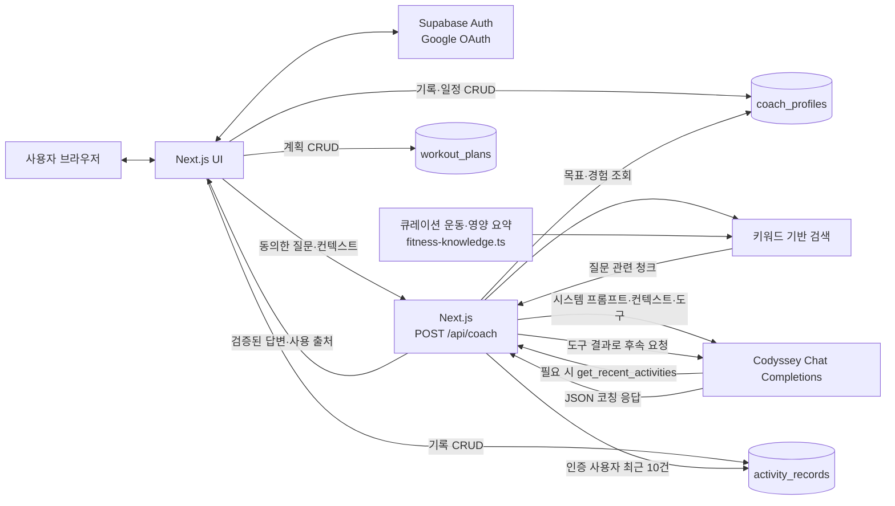

# Stride 시스템 아키텍처

## 1. 구성

- **웹 앱:** Next.js App Router, React, TypeScript
- **인증·데이터:** Supabase Auth, Postgres, 사용자별 Row Level Security (RLS)
- **AI:** Codyssey OpenAI 호환 Chat Completions API
- **배포:** Vercel

## 2. 시스템 흐름

## 3. AI 코칭 요청 순서

1. 사용자가 로그인하고 AI 전송 동의를 선택한 뒤 코칭 질문과 선택 컨텍스트를 제출한다.
2. `src/app/api/coach/route.ts`가 세션을 확인하고 질문·연령대·피로도·수면·통증·가능 시간의 형식과 범위를 검증한다.
3. API는 사용자 본인의 저장된 목표·경험을 읽고, `searchFitnessKnowledge`로 질문과 일치하는 지식 청크를 최대 4개 찾는다. 검색된 청크만 모델 입력에 포함한다.
4. API는 Codyssey 모델에 시스템 프롬프트, 사용자 입력, RAG 자료와 `get_recent_activities` 도구 정의를 전달한다.
5. 모델이 운동 이력이 필요하다고 판단해 도구를 요청하면, 서버가 도구 이름·인자를 검증한 뒤 인증된 사용자 ID로 최근 운동 기록 최대 10건을 읽는다. 조회 결과를 모델에 반환해 최종 답변을 생성한다.
6. API가 JSON 응답 필드·RPE·안전 수준을 검증하고 답변과 실제 검색된 출처를 UI에 반환한다.

## 4. 데이터 모델과 접근 경계

| 테이블 | 용도 | 접근 제어 |
| --- | --- | --- |
| `activity_records` | 사용자 운동 종류, 시간, RPE, 선택적 거리, 운동 시각 | `user_id = auth.uid()` RLS |
| `coach_profiles` | 사용자별 목표와 운동 경험 | 사용자 본인 행만 RLS 허용 |
| `workout_plans` | 사용자별 날짜·운동 계획 | `user_id = auth.uid()` RLS |

연령대와 당일 컨디션은 코치 API 요청에만 포함하고 DB에 저장하지 않는다. AI 대화 기록도 보관하지 않는다. 로그인 전 운동 기록은 브라우저 로컬 저장소에만 존재하며, 사용자가 로그인 후 명시적으로 가져올 수 있다.

## 5. RAG 지식 흐름

- 자료는 코드에 큐레이션 요약으로 저장한다. 출처는 Better Health Channel (State Government of Victoria)과 Mayo Clinic이다.
- 질문에 포함된 한국어·영어 키워드와 지식 청크 키워드를 비교해 관련 자료를 고른다.
- 실시간 웹 요청, 임베딩, 벡터 DB는 사용하지 않는다. 질문에 맞는 자료가 없으면 출처를 임의로 붙이지 않는다.
- 출처 목록은 모델이 생성한 URL이 아니라 서버가 선택된 청크의 메타데이터로 구성한다.

## 6. 보안·실패 처리

- AI 코치 API는 로그인과 명시적 동의를 요구한다.
- 최근 운동 조회는 서버에서 인증 사용자 ID로 제한하고 최대 10건만 가져온다.
- Codyssey 키는 서버 환경변수에 둔다. 브라우저에는 Supabase 공개 키만 사용하고 service role 키는 사용하지 않는다.
- 입력 범위를 벗어나거나 AI JSON 형식이 맞지 않으면 오류 응답을 반환한다. Codyssey 요청은 최대 45초로 제한한다.

## 7. 배포와 검증

- **프로덕션 URL:** https://runner-ai-coach.vercel.app
- **평가용 개인 포크:** https://github.com/deu061385-lgtm/Final-Project
- 코드 변경은 GitHub `main` 브랜치에 기록하고 Vercel 프로덕션에 배포한다.
- 프로덕션 빌드 및 AI/RAG 응답 형식은 개발 과정에서 확인했다. 외부 실사용자 최소 5명 테스트 결과와 개선 내역은 별도 수집·기록해야 한다.