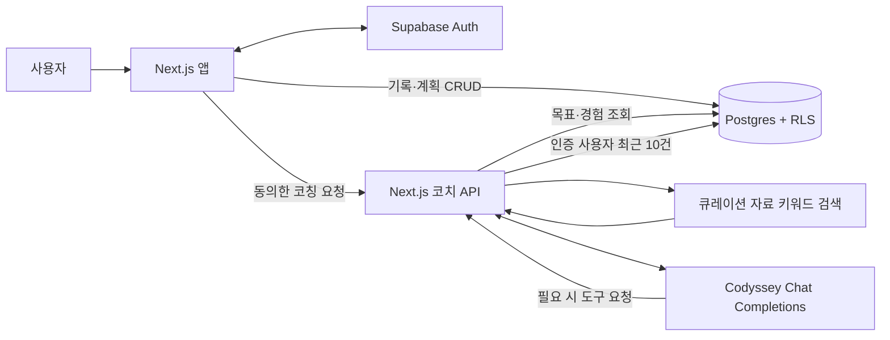

# Stride 발표 자료

## 1. Stride: 운동 기록에서 다음 코칭까지

러닝과 여러 운동을 기록하고, 운동 흐름과 참고 자료를 바탕으로 다음 활동을 계획하도록 돕는 AI 코치 서비스입니다.

- 배포: [runner-ai-coach.vercel.app](https://runner-ai-coach.vercel.app)
- 팀 프로젝트: AI 네이티브 Final Project

---

## 2. 문제와 사용자

러닝과 축구·근력 운동 등을 병행하는 일반 사용자는 운동 이력, 회복 상태와 다음 운동 계획을 여러 곳에서 관리해야 합니다. 기록만으로 최근 운동량과 오늘의 컨디션을 함께 고려하기도 어렵습니다.

Stride는 러닝을 중심으로 여러 활동을 관리하고 싶은 초급·중급 수준의 일반 운동 사용자를 위해 기록, 일정과 개인 맥락 기반 코칭을 한곳에 제공합니다.

---

## 3. 제품 흐름

1. 사용자가 운동 종류·시간·체감 강도를 기록하고, 러닝은 거리도 입력합니다.
2. 로그인 사용자는 계정 기록을 확인하고 날짜별 운동 계획을 추가·조회·삭제합니다.
3. 사용자가 AI 전송에 동의하고 목표·경험 및 선택적인 오늘의 컨디션과 함께 코칭을 요청합니다.
4. AI가 운동 이력이 필요하다고 판단하면 서버 도구로 본인의 최근 기록을 조회합니다.
5. 운동·영양 질문에는 관련 참고 자료를 검색해 답변과 출처를 제공합니다.

---

## 4. 시스템 구성

브라우저는 계정 기능에 Supabase 공개 키를 사용하고, 계정 데이터는 RLS로 사용자별 접근을 제한합니다. Codyssey API 키는 서버 환경변수에서만 사용합니다.

---

## 5. AI 네이티브 설계

**Long-term Memory**

사용자별 운동 목표·경험과 운동 기록을 계정에 저장해 다음 코칭 요청에서 활용합니다. 대화 이력은 저장하지 않습니다.

**RAG**

운동·영양에 관한 큐레이션 자료에서 질문 키워드와 일치하는 내용을 검색해 모델 입력에 넣습니다. 답변에 실제 선택된 자료의 출처를 표시합니다.

**AI Agent 도구 사용**

모델이 운동 이력을 근거로 답해야 한다고 판단하면 `get_recent_activities`를 요청합니다. 서버가 도구 요청을 검증한 뒤 로그인 사용자의 최근 운동 기록 최대 10건을 읽어 모델에 돌려줍니다.

현재 RAG는 로컬 자료의 키워드 검색이며, Agent도 최근 기록을 읽는 단일 도구 범위입니다. 실시간 웹 검색, 벡터 검색, 자율 다단계 계획은 구현하지 않았습니다.

---

## 6. 안전과 개인정보

- 코칭 요청 전 로그인과 AI 데이터 전송 동의를 확인합니다.
- 연령대·당일 컨디션은 해당 요청에만 사용하고 DB에 저장하지 않습니다.
- 대화 이력은 저장하거나 다음 요청에 전달하지 않습니다.
- 사용자 데이터는 Supabase RLS 및 서버의 사용자 ID 필터로 분리합니다.
- AI 생성 운동 가이드임을 표시하며, 진단·치료·개인별 식단 처방은 제공하지 않습니다.
- 통증이나 위험 증상에는 보수적인 안내와 전문가 상담을 우선합니다.

---

## 7. 사용자 의견과 반영

팀원 보고와 사용자 확인 기준 총 5명이 배포 앱을 사용하고 설문을 완료했습니다. Google 응답 시트 대조와 항목별 빈도 집계는 남아 있습니다. 아래 의견은 팀원이 익명으로 전달한 초기 요약이며 반복 빈도나 만족도 개선을 의미하지 않습니다.

- 팀원 보고 기준 5명이 운동 기록과 AI 코치를 사용했습니다. 한 익명 응답은 운동 계획과 일반 식단 안내가 편리했다고 보고했습니다.
- 테스터 2명이 대화 저장이 없어 답변을 캡처해야 하고 다른 기기에서 이어보기 어렵다고 보고했습니다. 대화 이력 저장은 미구현입니다.
- 2명 피드백 요약에서 데스크톱 글자·요소가 작고 여백이 많다는 점, 기록 선택지와 예시, 일정·코치 화면의 정보 밀도 및 데스크톱 홈 진입 개선 요청이 전달됐습니다. 기본 데스크톱 글자·요소 크기와 여백 조정은 CSS에 반영했으며, 기록 선택지·예시와 화면별 개선은 응답 시트 대조 및 프로덕션 확인이 남았습니다. 추가 응답 1명은 운동 종류 직접 추가, 기록·계획 화면 종류 통일과 AI 채팅 이력을 요청했습니다. 이 항목들은 아직 반영하지 않았습니다.
- 운동 전후 에너지·탄수화물·단백질·수분을 위한 일반 가이드와 큐레이션 자료 출처를 추가했습니다.
- 선택형 연령대와 오늘의 컨디션을 동의한 요청에 포함하도록 했습니다.
- 설문 13번 의견을 반영해 날짜별 운동 계획을 추가·조회·삭제할 수 있게 했습니다 (`32a5713`).
- 대화 이어 묻기, 데스크톱 UI 개선, 근력 세부 기록, 자세 영상과 웨어러블 연동은 아직 구현하지 않았습니다.

외부 사용자 테스트는 팀원 보고와 사용자 확인 기준 5명이며, 최소 기준을 충족했습니다. Google 응답 시트 대조와 항목별 빈도 집계는 남아 있어 최종 집계로 취급하지 않습니다.

---

## 8. 기술 선택

- **Next.js, React, TypeScript:** 화면과 서버 API를 한 프로젝트에 구성하고 요청·응답 타입을 명확히 관리합니다.
- **Supabase Auth, Postgres, RLS:** 계정 인증과 사용자별 관계형 데이터를 관리합니다.
- **Codyssey API:** 서버에서 모델 요청과 도구 호출을 제어하고 키를 클라이언트에 노출하지 않습니다.
- **Vercel:** Next.js 서비스를 외부에 배포하고 프로덕션 환경변수를 관리합니다.
- **일반 CSS:** 별도 UI 프레임워크 없이 MVP의 반응형 화면을 구성합니다.

---

## 9. 검증 현황과 한계

- 프로덕션 HTTP 200 및 Vercel 배포 `Ready` 상태를 기록했습니다.
- 로그인 사용자 1명의 코칭 요청에서 최근 기록 도구 사용 안내, 영양 가이드와 RAG 출처를 수동 확인했습니다.
- 팀원 보고와 사용자 확인 기준 배포 앱·설문 완료 5명이며, Google 응답 시트 대조가 남아 있습니다.
- 무관한 질문의 출처 미표시와 일정 기능의 외부 사용자 흐름은 추가 확인이 필요합니다.
- 자동화 통합·부하 테스트와 CI 검증은 현재 구성되어 있지 않습니다.

검증 상세: [배포 검증 기록](deployment-verification.md), [사용자 테스트 기록](user-testing.md)

---

## 10. 다음 단계

1. 실제 사용자 테스트 응답 수를 확인하고 익명 결과를 집계합니다.
2. 반복 의견을 우선순위화해 반영 여부와 사유를 기록합니다.
3. 팀원별 역할과 기여 설명을 확인합니다.
4. 평가 전 로그인, 기록, 일정, Agent 도구와 RAG 흐름을 다시 점검합니다.

제출 마감은 2026-11-08 18:00입니다. 테스트 결과나 팀원 확인을 추정해 완료로 기록하지 않습니다.

---

## 시연 순서

1. 홈에서 이번 주 개인 기록 요약을 확인합니다.
2. 기록 탭에서 운동 하나를 저장하고 내 기록 목록을 확인합니다.
3. 일정 탭에서 날짜를 선택해 운동 계획을 추가하고 삭제합니다.
4. 코치 탭에서 AI 전송 동의와 선택 컨텍스트를 확인한 뒤 운동 회복 질문을 보냅니다.
5. 답변의 최근 기록 활용 안내와 관련 질문의 참고 출처를 확인합니다.
